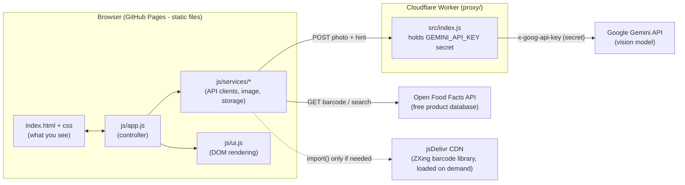
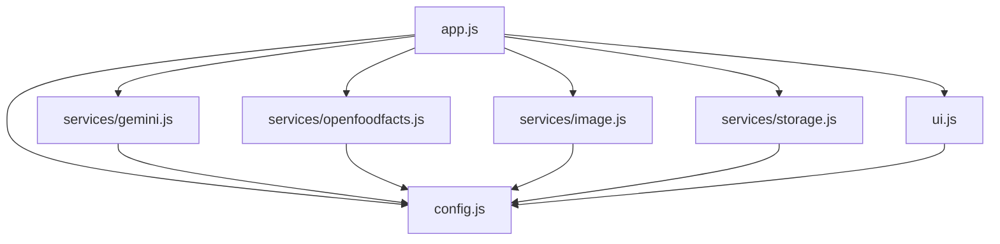
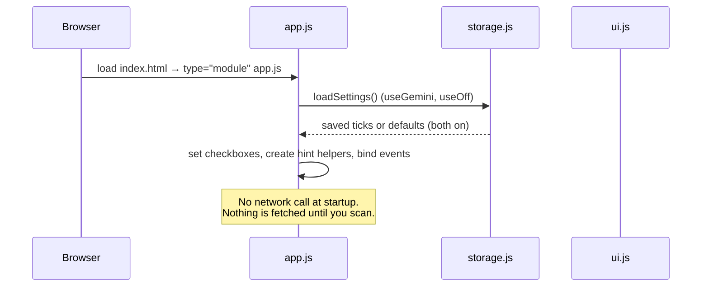
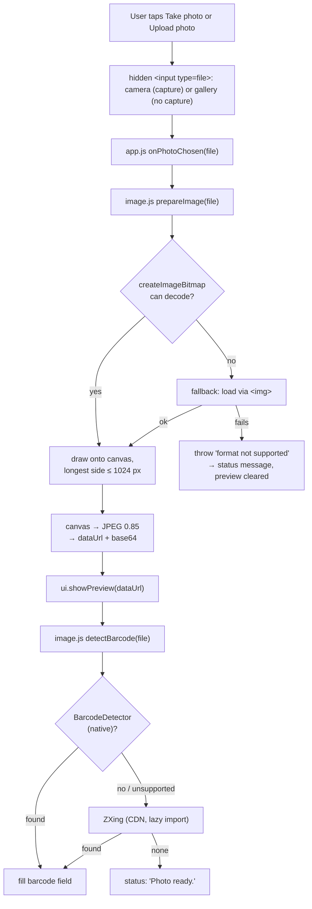
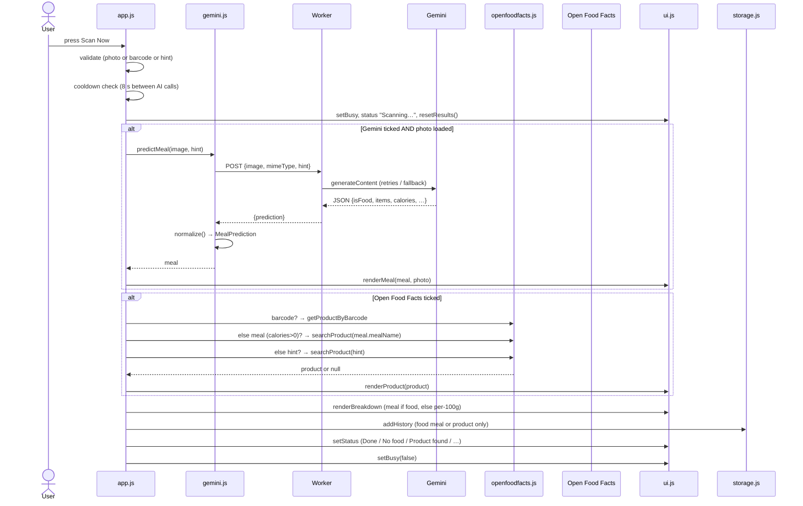
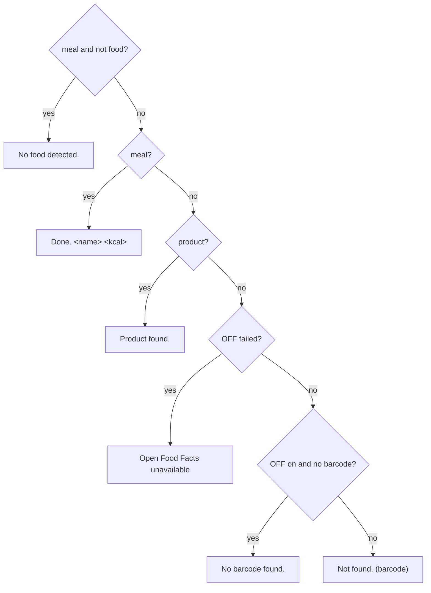
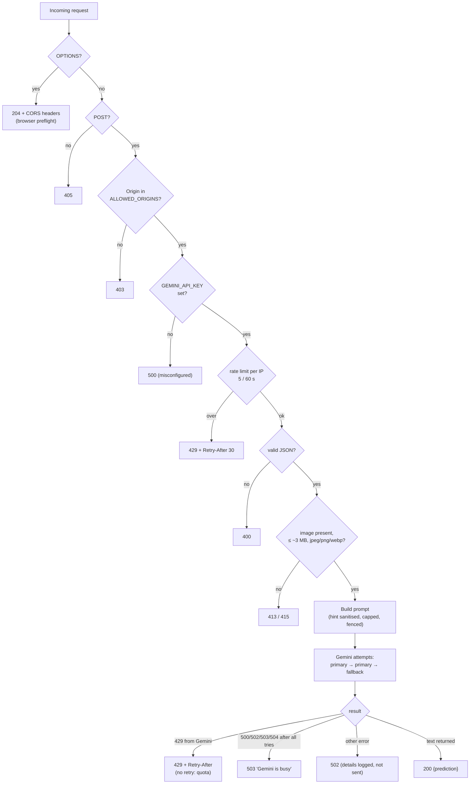
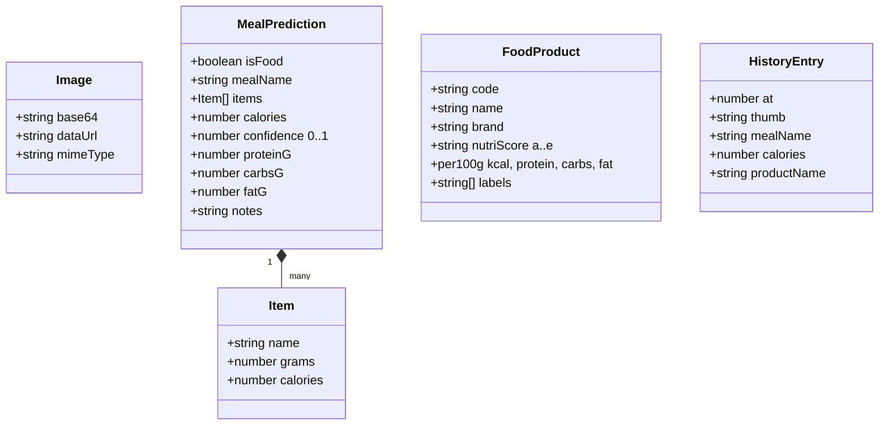

# NutriSnap – Code Guide

A file-by-file walkthrough of the code: what each piece does, how data moves through it, and why it was built that way. Diagrams use Mermaid and render on GitHub.

Contents
1. [The big picture](#1-the-big-picture)
2. [Repository map](#2-repository-map)
3. [Module dependencies](#3-module-dependencies)
4. [Startup](#4-startup)
5. [Photo flow](#5-photo-flow)
6. [Scan flow](#6-scan-flow)
7. [Worker (proxy) pipeline](#7-worker-proxy-pipeline)
8. [File reference](#8-file-reference)
9. [Data shapes](#9-data-shapes)
10. [Design decisions and reasons](#10-design-decisions-and-reasons)
11. [Known issues and next steps](#11-known-issues-and-next-steps)

---

## 1. The big picture

NutriSnap has **no server of its own for the page**. GitHub Pages serves static files. A **Cloudflare Worker** is the only server, and it exists for one reason: to hold the Gemini API key, which must never reach the browser or the repo.



**Why two halves?**
- The page is free to host and has no secrets.
- The Worker is the only place a secret can live. It also protects your Gemini quota (origin check, rate limit, retries).
- Open Food Facts needs no key and sends CORS headers, so the browser calls it directly.

---

## 2. Repository map

```
nutrition_cam/
├── index.html              page structure: capture panel, description card, results, dialogs
├── css/styles.css          all styling (palette as CSS variables, mobile-first)
├── js/
│   ├── app.js              controller: wires events, runs the scan, decides what to show
│   ├── ui.js               DOM writer: renders data, never fetches or stores
│   ├── config.js           every tunable number and URL in one place
│   └── services/
│       ├── gemini.js       calls the Worker, validates the answer
│       ├── openfoodfacts.js  barcode lookup + name search
│       ├── image.js        decode, downscale, barcode reading, thumbnails
│       └── storage.js      localStorage: settings and history
├── proxy/
│   ├── src/index.js        Cloudflare Worker: prompt, schema, Gemini calls, retries
│   ├── wrangler.toml       Worker config: vars, rate-limit binding
│   └── README.md           deploy steps
├── assets/logo.svg         logo and favicon
├── docs/                   design reference, roadmap, agentic-AI plan, this guide
├── .github/workflows/pages.yml   deploys the site to GitHub Pages on push to main
├── Theory.md               design rationale and architecture notes
└── README.md               setup and overview
```

---

## 3. Module dependencies

Arrows mean "imports". There are no cycles, and the UI never imports a service.



**Why this shape:** `app.js` is the only file that knows the whole flow. Services know their own API and nothing about the page. `ui.js` knows the page and nothing about the network. So you can replace Gemini with an agent by editing `gemini.js` alone (see `docs/AGENTIC_AI.md`).

---

## 4. Startup

What happens when the page loads, in order.



`app.js` runs top to bottom once as a module. It reads two saved settings, sets the two service checkboxes, and attaches event listeners. Nothing else happens until a user action.

---

## 5. Photo flow

What happens when you pick or take a photo.



**Why it's written this way:**
- **Downscale first.** Phone photos are 3–12 MB. A 1024 px JPEG is around 150–300 KB, which keeps the Worker under its size cap and cuts Gemini token cost.
- **Two decoders.** `createImageBitmap` is fast and handles EXIF rotation, but some browsers only decode a format through ``.
- **Barcode check on pick.** It runs once when the photo is chosen so the field is pre-filled. A packaged product's barcode is then ready to scan.
- **ZXing loads only when needed.** Chrome on Android and Safari have the native detector. Desktop Chrome and Firefox do not, so they pay the download only then.

---

## 6. Scan flow

The main event, `app.js onScan()`. This is what runs when you press **Scan Now**.



### The decision rules inside `onScan`

| Situation | What runs | Result shown |
|---|---|---|
| Photo + Gemini on | Worker → Gemini | Meal card; OFF search by the meal name if calories > 0 |
| Photo says *not food* | Worker → Gemini (`isFood:false`) | "No food detected"; no OFF search; not saved |
| Barcode typed or read | OFF by barcode | Product card (Nutri-Score, labels, per 100 g) |
| Only a description, Gemini off | OFF search by the text | Product card |
| Nothing at all | — | "Nothing to scan." |
| Within 8 s of the last AI call | — | "Please wait", countdown |

**Why OFF is searched by meal name only when calories > 0:** if Gemini says "not food" or returns nothing, searching the database with that text would give random matches.

**Why the barcode beats the meal name:** a barcode is an exact product. A name search is a guess.

**Why OFF failures don't erase the meal:** Open Food Facts is community-run and sometimes returns 5xx. The AI result is still valid, so the app keeps it and adds a note.

### The status line

`onScan` ends by picking one message. The order matters: the most specific case wins.



---

## 7. Worker (proxy) pipeline

Every request to the Worker goes through the same gates, in order. Each gate can stop the request early, so cheap checks run first.



### Retry timing

```mermaid
gantt
    title Worst-case Gemini call (all three attempts busy)
    dateFormat  s
    axisFormat  %Ss
    section Primary
    attempt 1 (≤25 s)      :a1, 0, 15s
    back-off 1.5 s         :b1, after a1, 2s
    attempt 2 (≤25 s)      :a2, after b1, 15s
    back-off 3 s           :b2, after a2, 3s
    section Fallback
    attempt 3 (≤25 s)      :a3, after b2, 15s
```



All attempts share one 50 s budget, so the Worker always replies before the browser's 60 s limit. Each attempt gets whatever time is left. A 429 is never retried, because retrying would only spend more quota.

---

## 8. File reference

### 8.1 `index.html`

**Purpose:** the page skeleton. It holds no logic, only named elements that `app.js` and `ui.js` find by id.

Layout, top to bottom:
- **Left panel (input):** brand, *Camera / Upload* heading with the **New item** refresh button, the photo dropzone with **Take photo** and **Upload photo** buttons, the service ticks, the barcode field, **Scan Now**, the *What's on your plate?* description card, and the footer with the Help and History icons and the status line.
- **Right panel (results):** *Detected Meal* card (photo, name, kcal, confidence, items, notes) and *Nutritional Facts* card (Nutri-Score, four breakdown bars, Open Food Facts labels, barcode).
- **Two dialogs:** Help (`#settings-dialog`) and History (`#history-dialog`). They use the native `<dialog>` element, so they need no JavaScript to open and close.

**Why ids everywhere:** the JS needs stable handles. Using `getElementById` avoids a framework and keeps the markup readable.

**Why two inputs:** `capture="environment"` opens the rear camera on phones, but it also blocks the gallery. The **Upload** input omits it so the gallery and files open instead.

### 8.2 `css/styles.css`

**Purpose:** all the look. Sections in order:
1. **`:root` variables**: the palette (cream, greens, orange, blue, yellow) and radius and shadow. Change a colour here and the whole site follows.
2. **Layout:** one column on phones; two panels from 900 px up.
3. **Brand and capture:** dashed dropzone, the two-column capture grid from 560 px.
4. **Controls:** service pills, barcode field, buttons.
5. **Meal hint card:** description box and quick-add chips (`.chip.is-on` highlights a chip already in the text).
6. **Footer, result cards, bars, grade colours, badges, dialogs, history.**

**Why CSS variables:** the design reference is a specific palette. One place to change it keeps the design consistent.

**Why mobile-first:** the camera is the main input, so the phone layout is the default and wider screens add columns.

### 8.3 `js/app.js` (controller)

**Purpose:** the only file that knows the whole program. It turns user actions into service calls and results into UI updates.

| Function / block | What it does | Why |
|---|---|---|
| Init block | Restores the two service ticks from storage | Remembers your choice between visits |
| `hintBox` helpers (`syncHint`) | Live counter, highlights chips already present | Shows the 300-character limit and which quick-tags are used |
| Chip click handler | Appends a qualifier with a comma, skips duplicates | Builds a description without typing |
| `new-btn` handler | Clears photo, description, barcode, results | Starts a fresh item; clearing the file input lets the same photo be chosen again |
| `onPhotoChosen` | Loads the photo, previews it, detects a barcode | Gives feedback immediately |
| `onScan` | The whole scan (section 6) | One place for the decision rules |
| `saveToHistory` | Stores a small thumbnail and the result | Only food or product results are kept |

**Important details:**
- `blockedUntil` is a timestamp. A scan is refused while `Date.now() < blockedUntil`. It is set to `now + 8 s` before each AI call, and to `now + Retry-After` after a 429. This is the client-side guard that protects your quota.
- `state` holds the current photo in memory only. It is not saved, so a page reload clears it.
- `ui.resetResults()` runs at the start of every scan, so a re-run never shows stale numbers.
- `RateLimitError` is caught separately from other errors so the message can include a countdown.

### 8.4 `js/ui.js` (view)

**Purpose:** writes data into the page. It has no `fetch` and no storage.

| Function | Writes |
|---|---|
| `showPreview` / `resetPreview` | The photo in the dropzone; swaps the "Take Photo" hint |
| `setStatus(title, text, isError)` | The footer line and its red error style |
| `setBusy(busy)` | Disables Scan Now and changes its label to "Scanning…" |
| `renderMeal(meal, photo)` | Meal name, kcal, confidence bar and percentage, items line, notes |
| `renderBreakdown(values, basis)` | Four bars scaled to the daily values in `config.js`; the basis label |
| `renderProduct(product, barcode)` | Nutri-Score grade, product name and brand, label badges, barcode |
| `resetResults()` | Puts every result card back to its dash state |
| `renderHistory(items)` | The list in the history dialog |
| `esc(s)` | Escapes text before it goes into `innerHTML` |

**Why `esc` exists:** Open Food Facts data is written by users. A product name like `` must be shown as text, not run as HTML.

**Why the bars use `Math.min(100, …)`:** a very large meal would otherwise overflow the bar.

### 8.5 `js/config.js` (settings)

**Purpose:** every number and URL you might change, in one file.

| Key | Value | Meaning and reason |
|---|---|---|
| `proxy.url` | Worker URL | Where AI requests go |
| `proxy.timeoutMs` | 60000 | Browser gives up after 60 s. Must exceed the Worker's worst-case retry time (~50 s) |
| `scan.cooldownMs` | 8000 | Minimum gap between AI calls, to protect quota |
| `scan.defaultRetryAfterS` | 30 | Wait used when the server sends no `Retry-After` |
| `openFoodFacts.baseUrl` / `fields` | world.openfoodfacts.org, a short field list | Only fetch what the UI shows, to keep responses small |
| `image.maxSide` | 1024 | Longest photo side in pixels: enough detail for food, small upload |
| `image.jpegQuality` | 0.85 | Compression quality for the upload |
| `dailyValues` | 2000 kcal, 50 g protein, 275 g carbs, 78 g fat | Reference for the bar lengths (share of a typical day) |
| `historyLimit` | 20 | Scans kept in the browser |

### 8.6 `js/services/gemini.js` (AI client)

**Purpose:** send a photo to the Worker and return a clean, safe object.

- **`predictMeal(image, hint)`**
  1. Checks a proxy URL is set.
  2. Sends `{image, mimeType, hint}` as JSON, with a timeout.
  3. Turns a network timeout into a readable message.
  4. On HTTP 429, throws `RateLimitError` with the wait time.
  5. On other errors, throws the Worker's `error` text. The Worker never sends raw Gemini output.
  6. Passes the answer through `normalize`.
- **`normalize(raw)`**: the defensive layer.
  - Converts every number, clamps negatives to zero, and limits confidence to 1.
  - Replaces the model's total kcal with the **sum of item calories**. Models often get arithmetic wrong, and the items are what they actually reasoned about.
  - Sets confidence to 0 when there is no food, so a "no food" answer never shows a full bar.
  - `isFood` defaults to `true` unless the model says `false`.
- **`RateLimitError`**: a small class, so the controller can tell this error apart and show a countdown.

**Why the client does not call Gemini directly:** the key would be exposed. The client only knows the Worker's address.

### 8.7 `js/services/openfoodfacts.js` (product client)

**Purpose:** look up a product by barcode, or find the closest match by name.

- **`getProductByBarcode(barcode)`**: keeps digits only, calls `/api/v2/product/{code}.json`, and returns `null` unless `status === 1`.
- **`searchProduct(query)`**: calls `/cgi/search.pl` for the top hit. Searching is a best guess, so it is only used when there is no barcode.
- **`getJson(url)`**: a **404 means "not found"**, returned as an empty object. Open Food Facts uses 404 for unknown barcodes, and treating that as an error was a bug fixed earlier.
- **`normalize(p)`**: maps the raw record to the small shape the UI needs. It converts nutriment keys like `energy-kcal_100g` to readable names, validates the Nutri-Score letter a–e, and turns tags like `en:no-added-sugar` into "No added sugar".

**Why a free database instead of only the AI:** packaged products have a printed label. The database holds the manufacturer's numbers. The AI can only estimate.

### 8.8 `js/services/image.js` (photo tools)

**Purpose:** everything that touches pixels.

- **`prepareImage(file)`**: decodes, scales the longest side to `maxSide`, re-encodes as JPEG. Returns both a data URL (for the preview) and the raw base64 (for the API).
- **`decode(file)`** (private): tries `createImageBitmap`, then falls back to ``. If both fail, it throws a readable message.
- **`makeThumbnail(dataUrl)`**: a 96 px JPEG for the history list, so history never fills the browser's storage.
- **`detectBarcode(file)`**: native `BarcodeDetector` first, then ZXing. Both are limited to EAN and UPC formats, which are the ones on food packaging.
- **`detectBarcodeZxing`** (private): loads the library from jsDelivr only when called, and frees the object URL in `finally`.

### 8.9 `js/services/storage.js` (local memory)

**Purpose:** remember two things: the two service ticks, and the scan history.

- Keys: `nutrisnap.settings`, `nutrisnap.history`.
- `read` / `write` wrap `localStorage` in try/catch, because private browsing or blocked storage must not crash the app.
- `addHistory`: adds to the front, keeps the latest `historyLimit`, and drops the oldest entries if the browser's storage quota is full.
- Nothing here leaves the device.

### 8.10 `proxy/src/index.js` (Worker)

**Purpose:** the only trusted code. It holds the key, the prompt, the schema, and the policy.

Parts, in file order:
1. **Constants:** Gemini base URL, allowed image types, size cap, timeouts, retry delays, the set of retryable statuses.
2. **`SYSTEM_PROMPT`:** the instructions. The method runs in order:
   - **Step 0, food check:** decides if the photo is food, a drink, or a packaged product. Anything else returns `isFood: false`.
   - **Steps 1–5:** identify items, estimate grams using scale references, compute kcal per item from grams × kcal-per-gram, total the macros (checked against 4/4/9 kcal per gram), and set confidence bands.
   - **Rules:** estimate only visible food, use a label if legible, never refuse for uncertainty, and treat the user hint as strong but untrusted evidence.
3. **`buildUserPrompt(hint)`**: removes control characters and angle brackets, collapses spaces, caps at 300 characters, and wraps the text in `<user_hint>…</user_hint>`. The system prompt says the text is data, so a hint like "ignore your rules" is not followed. This was tested.
4. **`RESPONSE_SCHEMA`**: a JSON schema. Gemini must return exactly these fields, with types. Field descriptions guide the model (e.g. "Total kcal = sum of item calories").
5. **`fetch` handler**: the gates in section 7, then the Gemini call with retries, then the reply.
6. **`sleep`**: a small promise-based delay for the back-off.

**Why the prompt lives here:** the client can't change it, so the endpoint can only do meal analysis. Someone who finds the URL cannot use it as a free general Gemini proxy.

**Why `temperature` is not set:** Google advises against lowering it for newer models, so the default is used.

### 8.11 `proxy/wrangler.toml`

**Purpose:** Worker configuration.
- `ALLOWED_ORIGINS`: the only sites whose browsers may call the Worker. It is an origin (scheme + host), not a URL path.
- `GEMINI_MODEL` and `GEMINI_FALLBACK_MODEL`: which model to use, and the backup.
- `[[ratelimits]]`: the per-IP limit (5 per 60 s) bound to `env.RATE_LIMITER`.
- The API key is **not** here. It is a secret set with `wrangler secret put`.

### 8.12 `.github/workflows/pages.yml`

**Purpose:** publishes the site. On every push to `main`, GitHub uploads the repository root as a Pages artifact and deploys it. The proxy is deployed separately with `wrangler deploy`.

---

## 9. Data shapes

The objects that move between files.



The Worker's JSON reply is `{ prediction: MealPrediction }` on success, or `{ error: string }` with a status code on failure.

---

## 10. Design decisions and reasons

| Decision | Reason | Trade-off |
|---|---|---|
| Static site, no build step | GitHub Pages can host it free, and it is easy to read and change | No bundler conveniences such as npm packages |
| Plain ES modules | Native in every modern browser; each file is one readable unit | Imports are full URLs to CDNs (ZXing) |
| Key held by a Worker | The only way to keep a secret from a static site | One more service to deploy and maintain |
| Prompt and schema in the Worker | The endpoint can only analyse meals | Changing the prompt needs a redeploy |
| Structured JSON output | Reliable parsing, fewer failure modes | The schema must match the code exactly |
| Client recomputes total kcal | Models make arithmetic errors | The total can differ slightly from the model's own |
| Food check before estimating | Stops a random photo from getting a calorie figure | One extra judgement the model can get wrong |
| Retries + fallback model | Google's busy errors are brief | Slower worst case (~50 s) |
| 429 never retried | Retrying spends more quota | The user must wait |
| Client cooldown 8 s | Taps can't burn quota | A deliberate re-scan can be delayed |
| OFF called from the browser | No key needed; CORS allowed; saves Worker calls | OFF sees the visitor's IP |
| Barcode before name search | Exact match beats a guess | Needs a readable barcode |
| Store thumbnails, not photos | localStorage is small (about 5 MB) | History has no full photos |
| `esc()` on all user-sourced text | Prevents HTML injection from third-party data | Must remember to use it |
| No framework | Small app, fewer moving parts, easy to read | Manual DOM updates in `ui.js` |

---

## 11. Known issues and next steps

Found while writing this guide, not yet fixed:

1. **Unused constant** in `proxy/src/index.js`: `UPSTREAM_TIMEOUT_MS` is no longer read after the retry rewrite. It should be deleted.
2. **Non-food results show "0"** in the kcal slot. The status line is correct, but the number should show a dash.
3. **Rate limit is per IP**, so several people behind one mobile network share the five-per-minute quota.
4. **Local origins are allowed** while `ALLOW_LOCALHOST = "true"` in `proxy/wrangler.toml`. Set it to `"false"` before a public launch. Other origins must be listed in `ALLOWED_ORIGINS`.

Larger next steps are in [IMPROVEMENTS.md](IMPROVEMENTS.md). The agent design is in [AGENTIC_AI.md](AGENTIC_AI.md).
