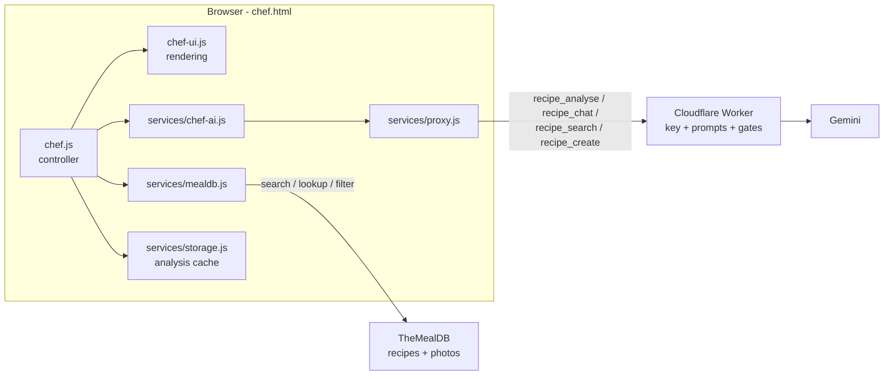
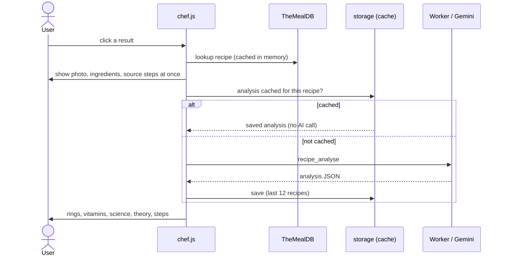

# NutriChef

NutriChef is the second page of the site (`chef.html`). Search a recipe, pick one, and get:

- **Nutritional facts per serving** (kcal, protein, carbs, fat) as rings, with a servings stepper.
- **Essential vitamins and minerals** as % of daily value.
- **Scientific insight**: the chemistry behind the key steps, plus cooking theory with the optimal temperature (°C and °F) and food-safety temperatures.
- **Making steps**, rewritten clearly with temperatures and times.
- **A chat** with Gemini about the recipe: higher protein, healthier, fewer calories, or "explain the science".

Design reference: [`chef-design-reference.jpg`](chef-design-reference.jpg).

---

## 1. Which recipe API, and why

| Option | Key needed | Free tier | Verdict |
|---|---|---|---|
| **TheMealDB** | No (public test key `1`) | Free, no stated rate limit | **Chosen.** Photos, ingredients, instructions, categories; CORS is open so the browser calls it directly. About **790 recipes** (measured by listing A to Z): 167 desserts but only 7 vegan, 12 pasta, 14 starters, 19 breakfast, and no smoothies. |
| Spoonacular | Yes | **50 points per day**, backlink required, data may be cached for 1 hour only | Larger catalogue, but needs a secret key (a proxy route), the daily quota is tiny and the caching rule conflicts with our analysis cache. Not practical as a free replacement. |
| Edamam | Yes | Limited, with attribution rules | Strong nutrition data, key required. |
| Gemini alone | Already have | Shared quota | Can write any recipe, but costs a call per search and can invent details. Used only as a **fallback**. |

**Licence note.** TheMealDB's page says the test key is for development and educational use, and asks that you become a supporter if you release publicly on an app store. It does not address ordinary websites. If NutriChef grows, support them and use a production key (only `mealdbBase` in `js/config.js` changes).

**Why Gemini does the nutrition.** TheMealDB has no nutrition data, so Gemini works it out from the ingredient list (see section 4). It is an estimate, and the page says so.

---

## 2. Architecture

Same pattern as NutriSnap: a **controller** (`chef.js`), a **view** (`chef-ui.js`) and **services**. The view never fetches; the services never touch the page.

### Worker routes

One endpoint, several jobs chosen by an `action` field. Each job has its own validator, prompt and response schema (`proxy/src/tasks.js`).

| action | Sent by | Returns |
|---|---|---|
| `scan` | NutriSnap | Meal estimate from a photo |
| `recipe_analyse` | NutriChef, on selecting a recipe | Nutrition totals, vitamins, steps, science, theory, safety |
| `recipe_chat` | NutriChef chat | `{reply, suggestions}` |
| `recipe_search` | "Search smarter" button | `{dishNames, ingredients, category, interpretation}` |
| `recipe_create` | "Create this recipe" button | A recipe object |

---

## 3. How a recipe is opened

Reasons for the order:
- **The recipe appears instantly** from the database; the AI part fills in after. If Gemini is busy, the page still works and offers **Try again**.
- **Cache.** Reopening a recipe costs no AI call, which protects the free quota.
- **Servings stepper is client-side.** Gemini returns totals for the whole recipe; the page divides by the chosen servings, so changing the number is instant and free. Vitamin percentages scale the same way.
- **Totals are recomputed in the browser** from the per-ingredient values, because models are unreliable at arithmetic.

---

## 4. The prompts

All prompts live in `proxy/src/prompts/chef.js`. Common rules: text from the database and from users is **cleaned, length-capped and fenced in tags**, and every prompt says that fenced text is data and any instruction inside it must be ignored.

### 4.1 Recipe analysis (the theory prompt)

Role: a registered dietitian who is also a food scientist. Seven ordered steps:

1. **Servings** from the recipe, else inferred from total quantity (about 350-450 g per adult serving).
2. **Ingredient nutrition**: one entry per ingredient, with a conversion table (cup of flour about 125 g, tablespoon of oil about 14 g, and so on) and totals for the whole recipe.
3. **Vitamins and minerals**: the 5-6 strongest contributions, scored against stated daily values.
4. **Steps**: 4-10 steps in the **same order** as the source, with temperatures in both units; a temperature the source did not give is marked "(suggested)".
5. **Science (chemical behaviour)**: only processes that actually occur in this recipe, from a named list with their temperature thresholds (Maillard above about 140 °C, protein coagulation ranges, starch gelatinisation 60-80 °C, caramelisation about 160 °C, collagen to gelatin, vitamin loss...). Each entry: topic, what changes at molecular level, why it matters.
6. **Cooking theory and optimal temperature**: techniques the recipe really uses, each with the optimum **for that technique** (oven, pan, target internal or resting temperature), never an unrelated temperature. Plus food-safety minimum internal temperatures.
7. **Metadata**: times, difficulty, tags from a fixed list, only if true.

Why it is written this way:
- **Fixed method and fixed vocabulary** make answers consistent and checkable, instead of generic cooking advice.
- **"Only what actually occurs"** stops the model listing every textbook reaction.
- **Temperature rules** were tightened after a test returned an unrelated temperature for a technique.
- **Structured output** (JSON schema) guarantees the fields the page needs.

### 4.2 Chat

A friendly dietitian and food scientist who knows **one** recipe and its nutrition per serving. Replies are at most about 120 words: a lead sentence and up to four bullets. Every suggestion names the swap, the amount, the estimated effect per serving, and any change to temperature or timing. It must stay on food, say it is not medical advice, and return 2-3 follow-up question chips.

The page sends the last 8 messages. The history must alternate user and assistant, so a failed turn is removed before the next one.

### 4.3 Smart search

TheMealDB can only be searched by dish name, **one** main ingredient, or a category. The prompt converts a natural request ("high protein chicken dinner", or a request in another language) into up to 3 dish names, up to 3 ingredients and one category, and maps goals to real ingredients (high protein: chicken, beef, salmon, eggs, lentils). The page runs those searches and merges the results.

### 4.4 Create a recipe

Used only when the database has nothing. It must produce a cookable recipe with precise measures, numbered steps with temperatures and times, and a category and cuisine. The result is then analysed like any other recipe. It is labelled "Created by Gemini".

---

## 5. Making search easier

- **Search as you type** (400 ms pause), or press Enter.
- **Dish or Ingredient** toggle, since "chicken" is both.
- **Category chips** loaded from the database.
- **Surprise me** picks a random recipe.
- **Automatic fallback**: a dish search with no match also tries the same word as an ingredient.
- **Few or no results?** Because the free database is small, two optional buttons appear whenever a search finds fewer than 5 recipes, so an AI call is a deliberate choice: *Search smarter with Gemini* and *Create this recipe with Gemini*.
- **Shareable links**: `chef.html?r=52772` opens a recipe directly.

---

## 6. Protections and limits

| Control | Where | Purpose |
|---|---|---|
| Origin allow-list, per-IP limit (10 per minute), body-size check | Worker | Protects the Gemini key and quota |
| Cooldown between AI requests (3 s) | `config.js` `chef.cooldownMs` | Stops rapid taps burning the quota |
| 429 handling with a wait message | `proxy.js`, `chef.js` | Backs off instead of retrying blindly |
| Analysis cache (12 recipes) | `storage.js` | Fewer AI calls |
| Input fencing and length caps | `proxy/src/prompts/chef.js` | Prompt-injection defence |
| Chat message cap (400 characters) | `config.js` | Limits cost and abuse |

---

## 7. Privacy

Recipe text, and chat messages you type, are sent to Google Gemini through the Worker. Nothing is stored by the Worker. The browser keeps an analysis cache (recipes only, no chat) in `localStorage`. The scan counter records only the kind of request (`recipe`, `chat`, `recipe_search`, `recipe_create`), never text. No cookies.

## 8. Extending

- **More recipes**: add Spoonacular behind a Worker route and merge results in `mealdb.js`.
- **Save favourites**: a list in `storage.js`.
- **Meal plans and shopping lists**: combine several analyses.
- **Agent**: see [AGENTIC_AI.md](AGENTIC_AI.md). The chat is the natural place for tools such as "swap this ingredient and recompute the nutrition".
